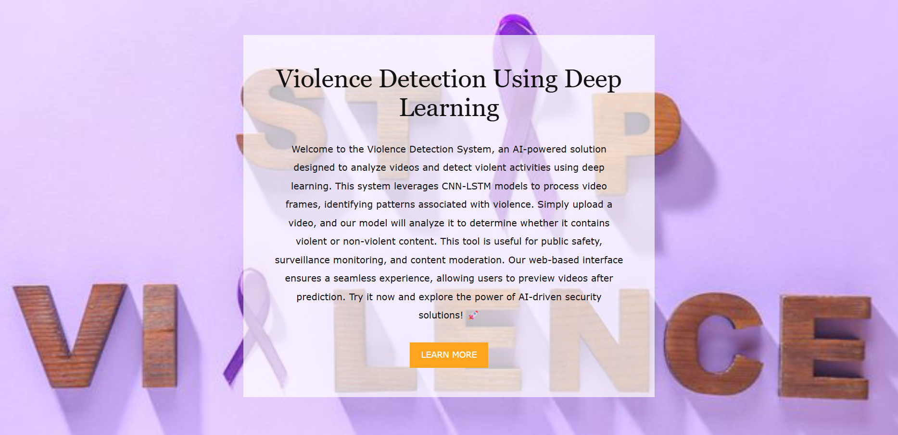
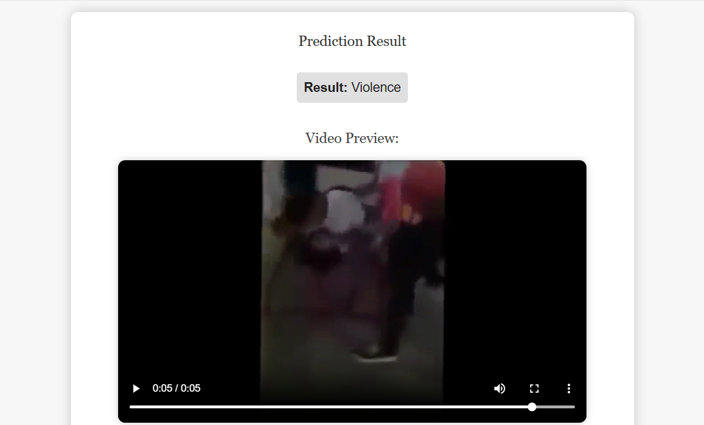
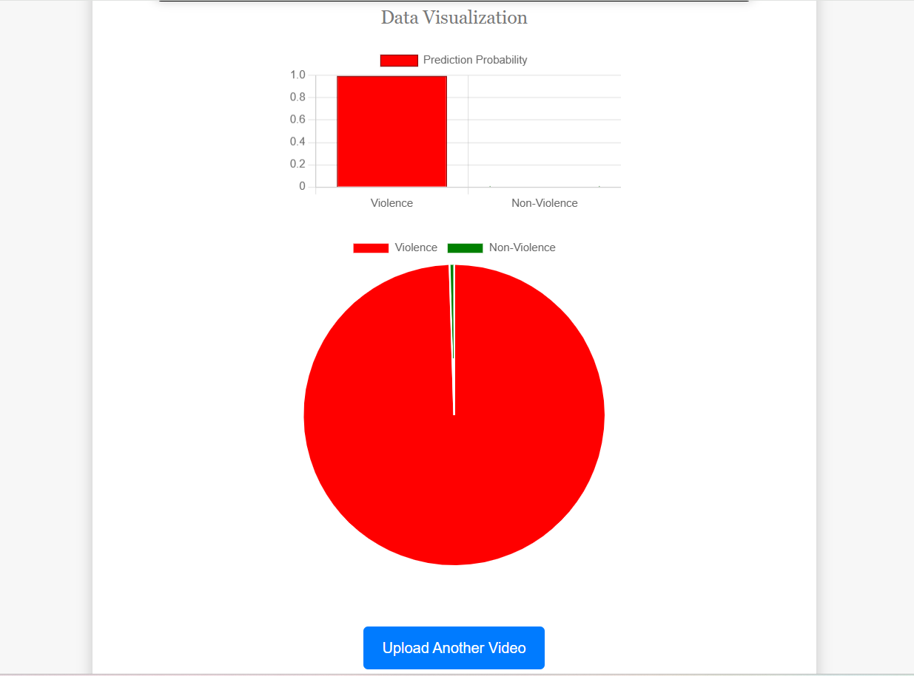
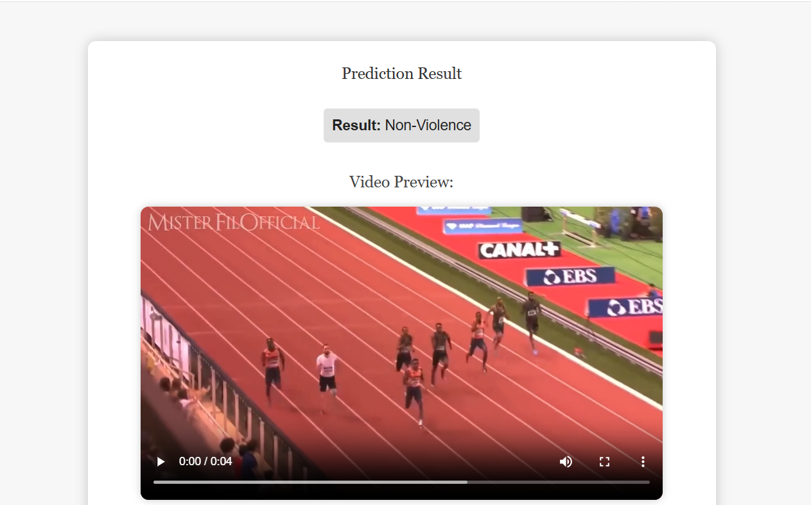
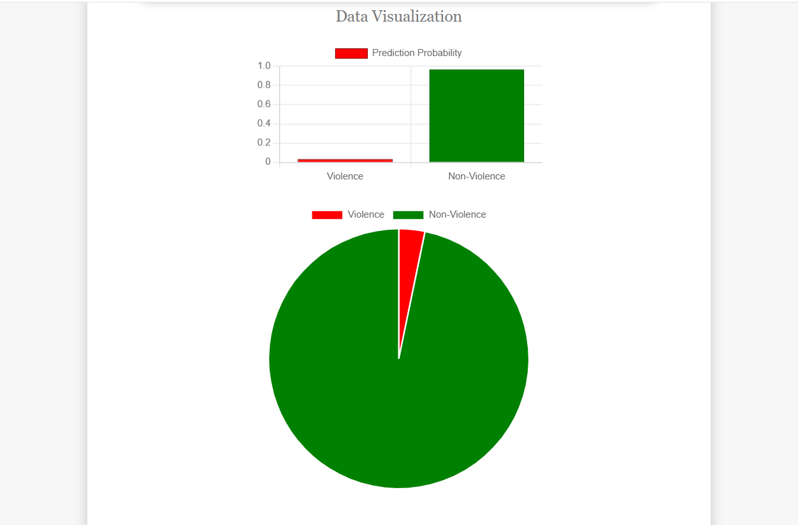

# Smart Anti-Violence System Using Deep Learning Based Video Surveillance

## 📌 Project Overview

A deep learning-based video surveillance system designed to automatically detect violent activities from video input. The system aims to automate violence monitoring and support faster identification of potentially violent incidents in surveillance footage.

The project combines deep learning and computer vision techniques with a web-based application for processing video input and generating violence detection results.

---

## 🎯 Objectives

- Automatically detect violent activities from surveillance video.
- Reduce dependence on continuous manual monitoring.
- Process video input using deep learning and computer vision techniques.
- Generate automated violence detection results.
- Provide a foundation for real-time violence monitoring and alert systems.

---

## 🧠 Technologies Used

- **Programming Language:** Python
- **Deep Learning:** TensorFlow, Keras
- **Computer Vision:** OpenCV
- **Numerical Computing:** NumPy
- **Data Analysis:** Pandas
- **Machine Learning Utilities:** Scikit-learn
- **Visualization:** Matplotlib
- **Video Processing:** MoviePy
- **Web Framework:** Flask
- **Password Hashing:** Argon2
- **Development Environment:** Jupyter Notebook, Anaconda

---

## 🧠 Deep Learning Model

The project uses a trained deep learning model to classify video sequences as violent or non-violent.

**Model file:** `violence_detector.h5`

**Classification categories:**

- `0` — Non-Violence
- `1` — Violence

The model processes video frames and produces a classification result based on the learned patterns in the training data.

The model is integrated into the project's prediction and application workflows.

---

## ⚙️ Project Workflow

```text
Video Input
     |
     v
Video Processing
     |
     v
Frame Extraction
     |
     v
Frame Preprocessing
     |
     v
Trained Deep Learning Model
     |
     v
Violence Classification
     |
     v
Violence / Non-Violence Result
```

---

## 📊 Model Performance

The model was evaluated using standard classification metrics.

| Evaluation Metric | Score |
|---|---:|
| Accuracy | 84% |
| Precision | 80% |
| Recall | 100% |
| F1-Score | 88.89% |

These metrics are used to evaluate the model's ability to identify violent and non-violent video samples.
**Note:** These results reflect the evaluated test dataset. Performance on real-world surveillance footage may differ depending on video quality, lighting, camera angle, and the characteristics of the input data.

---

## 📁 Project Structure

```text
smart-anti-violence-detection/
│
├── models/                   # Model-related files
├── scripts/                  # Supporting scripts
├── static/                   # Static web application assets
├── templates/                # Flask HTML templates
├── utils/                    # Utility modules
├── presentation/             # Project presentation
│
├── app.py                    # Main Flask application
├── predict.py                # Prediction functionality
├── create_database.py        # Database creation and setup
├── utils1.py                 # Supporting utility functions
├── __init__.py                # Python package initialization
├── violence_project.ipynb     # Project notebook
├── violence_detector.h5      # Trained deep learning model
├── requirements.txt          # Python dependencies
├── .gitignore                # Files excluded from Git
└── README.md                 # Project documentation
```

*The directory listing describes the intended project organization. Some folders or files may be excluded from the public GitHub repository, particularly large datasets and generated files.*

---

## 🖥️ Application and User Interface

The project includes a Flask-based web application that integrates the trained deep learning model for video-based violence detection.

Users can interact with the application to submit video input and view the model's classification result.

### Application Interface

The following screenshot shows the application's user interface.



### Violence Detection Result

This screenshots shows the example of the application classifying a video as containing violent activity.





### Non-Violence Detection Result

This screenshots shows the example of the application classifying a video as non-violent.




---

## 💻 Installation and Setup

Follow these steps to run the project locally.

### 1. Clone the Repository

```bash
git clone https://github.com/muhammedsinanta/Smart-Anti-Violence-System-Using-Deep-Learning-Based-Video-Surveillance.git
```

### 2. Navigate to the Project Directory

```bash
cd Smart-Anti-Violence-System-Using-Deep-Learning-Based-Video-Surveillance
```

### 3. Create a Python Virtual Environment

```bash
python -m venv violence
```

### 4. Activate the Environment

**Windows:**

```bash
.\violence\Scripts\activate
```

**Linux/macOS:**

```bash
source violence/bin/activate
```

### 5. Install Dependencies

```bash
python -m pip install --upgrade pip
python -m pip install -r requirements.txt
```

### 6. Verify the Model File

Ensure that the trained model is available at the path expected by the application.

```text
violence_detector.h5
```

If the model is stored inside the `models/` directory, update the model path in the relevant Python file if necessary.

**Note:** The application requires the trained model and any other required project assets to be present in their expected locations.

## 🚀 Running the Application

After installing the dependencies, run:

```bash
python app.py
```

If the application starts successfully, open the following address in your browser:

```text
http://127.0.0.1:5000
```

The application runs locally on your computer. This command does not deploy the application publicly to the internet.

To stop the application, press `Ctrl + C` in the terminal.

## 📦 Dependencies

The project uses the following Python packages:

```text
tensorflow
keras
opencv-python
numpy
pandas
scikit-learn
matplotlib
moviepy
flask
argon2-cffi
```

These dependencies should be listed in `requirements.txt`. Additional dependencies may be required depending on the imports used by the project's scripts.
